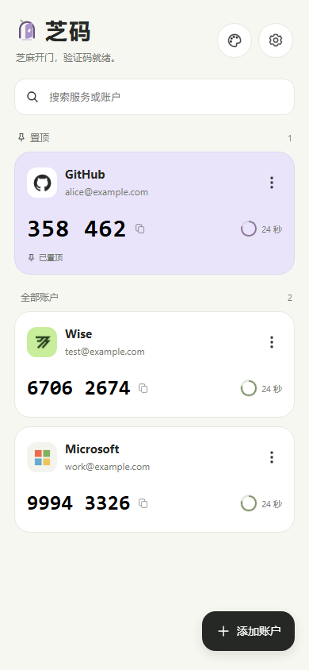
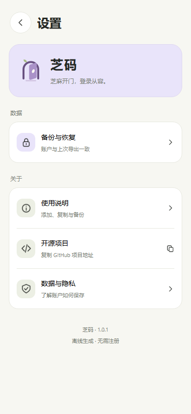

<p align="center">
  
</p>

<h1 align="center">芝码 · Zhima</h1>

<p align="center">芝麻开门，验证码就绪。</p>
<p align="center">一款离线生成两步验证验证码、支持加密备份的 Android 验证器。</p>

<p align="center">
  <a href="https://github.com/snowcgj/my-Auth/releases">下载 APK</a> ·
  <a href="#使用方法">使用方法</a> ·
  <a href="#数据与安全">数据与安全</a> ·
  <a href="LICENSE">MIT 许可证</a>
</p>

芝码从网站提供的验证二维码添加账户，在手机上生成动态验证码，无需注册芝码账号。它由一个 2024 年的个人项目逐步改造而来，仓库名仍保留为 `my-Auth`，使用 uni-app + Vue 3 开发。

**当前版本：1.0.1。** APK 已完成打包，维护者已反馈 Android 安装与迁移使用正常；GitHub Release 附件仍待上传，上传后可从上方入口下载。[本版说明与校验值](docs/releases/v1.0.1.md)

## 界面预览

| 账户首页 | 备份与恢复 | 设置 |
| --- | --- | --- |
|  |  |  |

以上图片由实际 Vue 组件和公开演示账户在浏览器中渲染，**不是 Android 真机截图**；系统相册、文件选择器和键盘以手机上的实际表现为准。

## 主要功能

- **扫码与图片识别**：扫描网站的 `otpauth://` 验证二维码，或从 Android 系统选图界面选择二维码图片。
- **离线验证码**：支持 SHA-1 / SHA-256 / SHA-512、6 / 8 位验证码和 30 / 60 秒周期；显示倒计时，点击验证码即可复制。
- **账户管理**：搜索、置顶、修改服务名和账户名、删除前确认。改名只影响显示，不更换密钥或验证码参数。
- **加密备份**：设置密码，将账户导出为 `.mabak` 文件；恢复时先解密预览，确认后合并，重复项保留现有账户。
- **备份提醒**：显示上次导出状态，账户配置或显示名称变化后提醒备份。
- **三种浅色背景**：暖白、雾紫、浅绿，搭配统一的操作面板、确认弹窗和等待提示。

## 使用方法

### 安装与添加账户

1. 从本仓库 [Releases](https://github.com/snowcgj/my-Auth/releases) 下载 APK，传到 Android 手机安装。
2. 在需要开启两步验证的网站中选择“验证器应用”，显示设置二维码。
3. 打开芝码，点击“添加账户”，扫描二维码或选择本地图片。
4. 将芝码生成的验证码填回网站，完成验证器绑定。以后登录时点击验证码即可复制。

设备时间会影响验证码，请保持系统时间准确。只扫描可信网站提供的验证二维码，不要公开自己的二维码或设置密钥。

### 备份与恢复

在设置中打开“备份与恢复”，选择创建备份，设置并再次输入密码，然后通过系统文件界面选择保存位置。应用会读回校验保存的文件，通过后才更新备份状态。

换机或重装时，选择备份文件、输入密码、查看解密预览，再确认合并。重复判断同时比较**密钥、算法、位数和周期**，保留现有账户及名称，显示名称不参与去重。

**备份密码无法找回。** 请在手机之外保留备份副本，单独保管密码；卸载或换机前先确认文件可用。将备份只放在同一部手机里，不能应对手机丢失。

### 从旧版迁移

- 本次新版包名为 `io.github.snowcgj.myauth`，与 2024 年旧版 `uni.UNI1835605` 可以分别安装，账户不会自动搬过来。
- 从本次 `Auth 1.0.0` 升级到 `芝码 1.0.1`，包名与签名保持一致，可直接覆盖安装；**不要先卸载**。
- 如果旧版没有可用的导出功能，可以登录对应网站，在安全设置中更换验证器，用芝码扫描新二维码并完成验证。确认新绑定能登录后再处理旧记录。GitHub 的具体操作见[官方说明](https://docs.github.com/en/authentication/securing-your-account-with-two-factor-authentication-2fa/changing-your-two-factor-authentication-method)。
- 网站的恢复码用于紧急登录，不能直接导入芝码生成动态验证码。其他验证器的备份格式也不保证能导入。

## 数据与安全

本项目没有账户云同步或自建后端。验证码在本地计算，账户保存在设备的 `uni` 本地存储中。

| 内容 | 当前保护方式 |
| --- | --- |
| 应用内账户 | 当前尚未做应用层加密，也没有应用锁；请妥善保护手机 |
| 导出的 `.mabak` 文件 | 使用密码加密并校验完整性；密码不保存在备份文件中，遗忘后无法找回 |
| 备份副本与密码 | 由使用者选择保存位置和保管方式，应用不提供托管或找回服务 |

**备份文件加密，不等于应用内存储已经加密。** 备份 v1 使用随机盐、PBKDF2-HMAC-SHA256（100,000 次）、AES-256-CBC 和 HMAC-SHA256 完整性校验。导出上限为 64 KiB，导入上限为 1 MiB。

二维码、设置密钥、恢复码和备份密码都不应提交到仓库、粘贴到 Issue 或放进公开截图。报告问题时请使用演示账户。

## 平台与限制

| 平台 | 支持情况 |
| --- | --- |
| Android | 当前开发与真机验收平台；已反馈本版安装、使用及 GitHub 账户迁移正常，不代表覆盖全部机型和系统版本 |
| H5 / 微信小程序 | 保留代码与配置，当前暂缓验收，原生选图和文件读写不保证可用 |
| iOS | 未验收，本次不提供安装包 |

目前不支持 HOTP、其他位数或其他周期，也没有手动输入密钥、修改验证码参数、云同步和应用锁。图片识别受格式、系统和解码引擎影响；启动画面固定使用暖白背景。最低 Android 兼容版本尚未完成系统性测试，不以某个 API 的最低版本代替兼容承诺。

## 开发与测试

使用过的环境：**HBuilderX 5.26、Node.js 22.11.0、npm 10.9.2**。

克隆仓库，进入内层应用目录安装依赖：

```sh
git clone https://github.com/snowcgj/my-Auth.git
cd my-Auth/my-auth
npm install
```

1. 用 HBuilderX 打开内层 `my-auth/`，即包含 `manifest.json`、`pages.json` 和 `App.vue` 的目录。
2. 安装 App 真机运行插件，连接开启 USB 调试的 Android 手机，通过“运行到手机或模拟器”启动。
3. 使用公开演示账户验证功能，不使用真实账户作为测试夹具。

在内层应用目录运行自动测试：

```sh
npm test
```

测试使用 Node 内置 `node:test`，覆盖 RFC 6238 三算法标准向量、独立实现对照、URI 解析、名称修改、备份加密与合并、平台调用编排和主题偏好。密码派生测试较耗时，整套约需 1–2 分钟；平台测试使用模拟桥接，不能代替 Android 真机验证。

项目使用 HBuilderX 运行和打包，当前没有 `npm run dev` 或 `npm run build` 脚本。

### 构建与打包

uni-app 能复用现有页面和跨端代码，但原生打包依赖 DCloud 的工具与 Runtime，需要为这部分准备留出时间：

- **云打包 / 安心打包**：高峰期可能排队，本项目实际遇到过较长等待。安心打包的云端原生包生成后，还需要本机合并页面资源并签名；希望自动完成时应保持 HBuilderX 运行、电脑联网且不进入睡眠。
- **本地离线打包**：需要与 HBuilderX 匹配的普通 uni-app Android 离线 SDK、DCloud 离线 AppKey 和签名证书。官方 SDK 下载可能通过网盘分发，渠道可用性会影响搭建；基础 Android 工具链可用，不等于本项目的离线 APK 已能构建。
- **后续升级**：保管好签名证书，同包名更新必须保持签名一致；证书、密码、AppKey 本地配置和构建产物不进入源码仓库。

详细步骤见 [Android 打包与发布](docs/android-release.md)；安心打包机制与 SDK 获取以 [DCloud 官方说明](https://uniapp.dcloud.io/tutorial/build/SafePack.html)和[离线 SDK 下载页](https://nativesupport.dcloud.net.cn/AppDocs/download/android.html)为准。基座运行通过后，仍需验收实际发行 APK。

### 项目结构

```text
my-auth/
├── pages/                  # 账户首页、设置、备份恢复
├── components/             # 账户卡片、名称编辑、主题、弹窗与等待反馈
├── utils/                  # TOTP、解析、账户、备份与平台适配
├── styles/                 # 主题变量和共用样式
├── static/branding/zhima/  # 图标、启动图、SVG 母版
├── scripts/                # 品牌资源生成工具，仅开发时使用
└── tests/                  # 自动测试
```

协作修改前请读 [AGENTS.md](AGENTS.md)；项目状态与验证记录见 [HANDOFF.md](HANDOFF.md) 和 [.ai/](.ai/)。部分早期实验文件暂留，实际入口以页面引用关系为准。

## 许可证

项目原创代码采用 [MIT License](LICENSE)。第三方依赖、服务标识和 DCloud 原生 Runtime 遵循各自许可证与使用条款。
