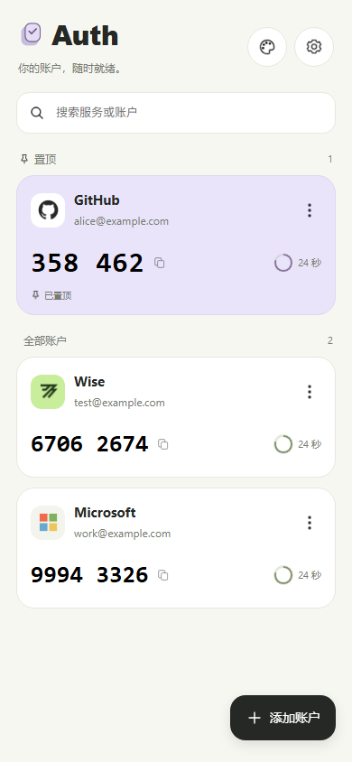
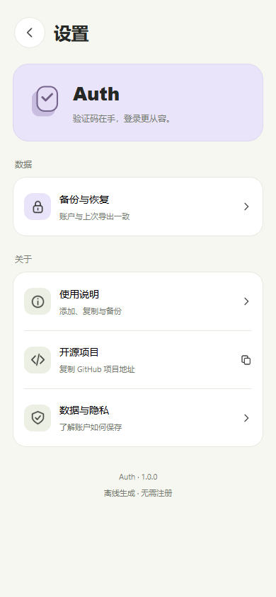
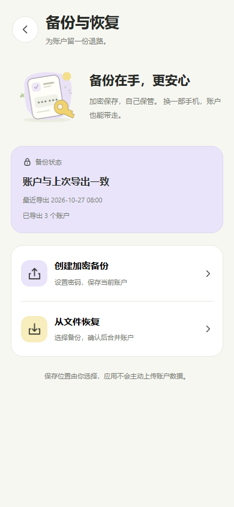

# my-Auth

一个本地 TOTP 二次验证器。扫描网站提供的验证二维码后，离线生成动态验证码，无需注册账号。使用 **uni-app + Vue 3** 开发，以 **HBuilderX 和 Android 真机**作为当前开发与验收环境。

## 界面预览

以下为使用公开演示数据生成的浏览器预览，不是 Android 真机截图；原生相册、文件选择器和键盘表现以设备运行结果为准。

| 首页 | 设置 | 备份与恢复 |
| --- | --- | --- |
|  |  |  |

## 可以做什么

- **添加验证账户**：相机扫描 `otpauth://` 二维码，或在 Android 系统选图界面选择本地图片识别。
- **离线生成验证码**：支持 SHA-1 / SHA-256 / SHA-512、6 / 8 位、30 / 60 秒周期，显示倒计时；点击验证码即可复制。
- **管理账户**：搜索、置顶、删除前确认，以及修改服务名称和账户名称。名称编辑只修改显示信息，不修改密钥和验证码配置。
- **加密备份与恢复**：设置密码后导出 `.mabak` 文件；恢复前解密预览，确认后合并，重复项保留已有账户。
- **查看备份状态**：提示验证码配置或显示名称是否发生未备份的变更。
- **切换背景**：顶部入口提供暖白、雾紫、浅绿配色。背景切换不影响账户数据；本轮主题功能的 Android 表现待验收。

## 开始运行

已使用的环境是 **HBuilderX 5.26、Node.js 22.11.0、npm 10.9.2**。更早版本未验证。

1. 克隆仓库，在仓库根目录执行：

   ```sh
   cd my-auth
   npm install
   ```

2. 使用 HBuilderX 打开内层 `my-auth/` 目录，即包含 `manifest.json`、`pages.json` 和 `App.vue` 的目录。
3. 安装 HBuilderX 的 App 真机运行插件，连接开启 USB 调试的 Android 手机，通过“运行到手机或模拟器”启动 App 基座。
4. 使用公开测试二维码验证流程，再处理自己的账户。不要把真实密钥、二维码或备份文件放进仓库。

此项目使用 HBuilderX 运行和打包，当前没有 `npm run dev` 或 `npm run build` 脚本。正式 APK 与开发基座需分别验证。

## 数据如何保存

账户保存在设备的 `uni` 本地存储中，没有项目后端或账户同步服务。验证码由本地密钥和设备时间计算，使用时应保持系统时间准确。

**加密备份与本地存储保护是两回事：备份文件已加密，本地账户存储目前没有应用层加密，也没有应用锁。**

### 备份与恢复

在“备份与恢复”中输入并确认密码，通过 Android 系统文件界面选择保存位置。文件写入后会读回验证；验证通过才更新备份状态记录。

备份 v1 使用随机盐、PBKDF2-HMAC-SHA256（100,000 次）、AES-256-CBC 和 HMAC-SHA256 完整性校验。**密码无法找回**，请在其他设备保留备份副本，并单独妥善保存密码；卸载应用或丢失设备前先确认备份可用。

恢复时依次选择文件、输入密码、查看预览、确认合并。重复判断同时比较**密钥、算法、位数和周期**；重复项保留已有账户及其名称，不用备份覆盖。显示名称不参与去重。

导出上限为 **64 KiB**，导入上限为 **1 MiB**。旧版本备份状态记录可能提示“建议重新备份一次”，重新导出后即可更新名称变更检测；旧文件仍可按原流程恢复。

## 平台与当前边界

| 平台 | 当前状态 |
| --- | --- |
| Android | 主要验收端；用户已反馈扫码、系统相册识别、SHA-256/SHA-512 及备份基础流程可用。名称编辑、背景主题和最终发行包仍需独立真机验收。 |
| H5 / 微信小程序 | 保留代码与配置，当前暂缓验收；Android 原生选图及文件读写能力不保证可用。 |
| iOS | 未验收。 |

- 不支持 HOTP、其他位数或其他周期；不支持的二维码参数会明确拒绝。
- 暂不提供手动输入密钥、修改验证码参数、云同步或应用锁。
- 启动窗口和原生页面底色仍使用默认暖白，其他背景在切页或滚动露底时的表现待真机确认。
- Android 原生相册识别受设备系统与解码引擎影响，不承诺所有图片格式和所有系统版本均可用。
- SAF 的 API 版本不等于应用最低支持版本；当前不对最低 Android 版本作兼容承诺。
- 部分早期实验文件尚保留，修改前请以主页面引用关系判断实际运行链路。

## 测试与结构

在内层应用目录运行：

```sh
npm test
```

测试使用 Node 内置 `node:test`。本轮 **126 项测试通过**，覆盖 RFC 6238 三种算法的标准向量、独立实现对照、二维码解析、账户修改、加密往返、合并、备份摘要和外观偏好持久化。平台测试使用模拟桥接，不能代替 Native.js、HBuilderX 打包或 Android 真机测试；PBKDF2 测试较耗时，整套约需 1–2 分钟。

主要代码位于 `my-auth/`：

| 位置 | 职责 |
| --- | --- |
| `pages/home/`、`pages/settings/`、`pages/backup/` | 账户首页、设置、备份恢复流程 |
| `components/` | 账户卡片、名称编辑器、ThemePicker、统一弹窗与等待反馈 |
| `utils/totp-core.js`、`utils/otpauth.js`、`utils/account.js` | 验证码计算、URI 校验、账户规范化与名称修改 |
| `utils/backup-crypto.js`、`utils/backup-merge.js`、`utils/backup-summary.js` | 备份加密、合并、状态摘要 |
| `utils/activity-result.js`、`utils/platform-image.js`、`utils/platform-file.js` | 原生结果分发、系统选图识别、SAF 文件读写 |
| `utils/platform-random.js`、`utils/theme.js`、`styles/theme.css` | 安全随机数、主题偏好与视觉变量 |
| `tests/` | 自动测试 |

协作前请阅读 [AGENTS.md](AGENTS.md)。当前阶段、架构和验证边界见 [HANDOFF.md](HANDOFF.md) 及 [.ai/](.ai/)。

## 制作 Android APK

正式打包由维护者在 HBuilderX 中进行，目前没有自动发布流水线。打包前需要核对：

1. 应用名称、Android 包名、版本名称与递增的版本号，以及应用签名。签名文件和密码不提交仓库。
2. `manifest.json` 中的模块与权限：当前已显式声明 `Barcode`；相册与备份使用用户授权的系统选择器，不需要为这些功能新增全盘存储权限。已有权限仍需按实际用途复核。
3. 正式应用图标和启动资源。当前配置引用 `unpackage/res/icons/` 中的生成文件，不能将该目录当作独立、完整的图标源资源。
4. 使用“发行 → 原生 App-云打包”等 HBuilderX 提供的流程生成 APK；菜单与配置以当前工具实际界面为准。
5. 安装生成的 APK，重新检查扫码、选图、复制、名称编辑、主题、重启与后台恢复、备份导出和恢复。基座调试通过不代表发行包已通过。

## 许可证

许可证待定，仓库当前未包含项目 LICENSE 文件。代码公开可见不代表已授予特定开源许可；暂不声明 MIT、Apache 等许可证。第三方依赖遵循各自许可证。
